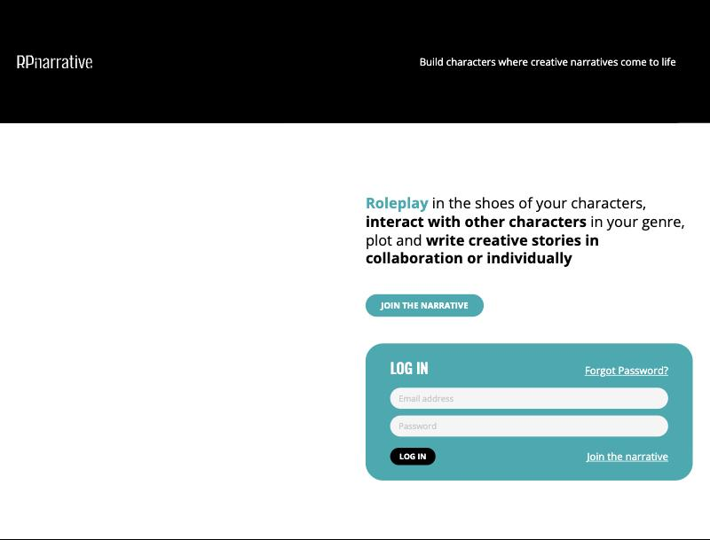

# RPnarrative

**A community platform for collaborative roleplay writing.** Writers build characters, connect with other characters in their genre, and write stories together or alone.

**Live:** [rpnarrative.com](https://rpnarrative.com)

## What it does
- Character profiles with face claims, genre, writing style, pronouns and reply speed
- Character search and connections between writers
- Shared chapters written in collaboration, plus a live chat room and activity stream
- Member badges, subscriptions and a full content management back office

## What's next
A mobile first rebuild with AI writing tools, and an AI character companion: the character you create becomes a persona you can talk to.

## Built with
ASP.NET and SQL Server (current platform). React and Node.js (web rewrite). Expo and PostgreSQL (mobile rebuild).

## About this repo
The source code is private. This page describes the platform and links to the live site.

Built by [Hiba Hassan](https://github.com/hibashassan).
